<p align="center">
  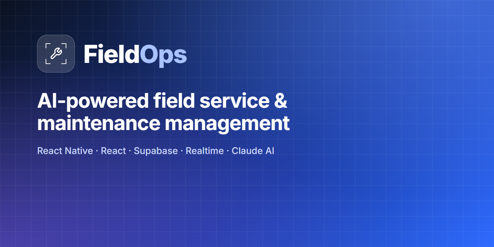
</p>

<p align="center">
  
  
  
  
  
</p>

**FieldOps** replaces paper work orders for companies with field technicians (HVAC, electrical,
plumbing, facility maintenance). Technicians run their day from a **mobile app**; dispatchers
manage everything from a **web dashboard that updates live**; and supplier invoices are
**read by AI** straight from a phone photo — no re-typing.

<p align="center">
  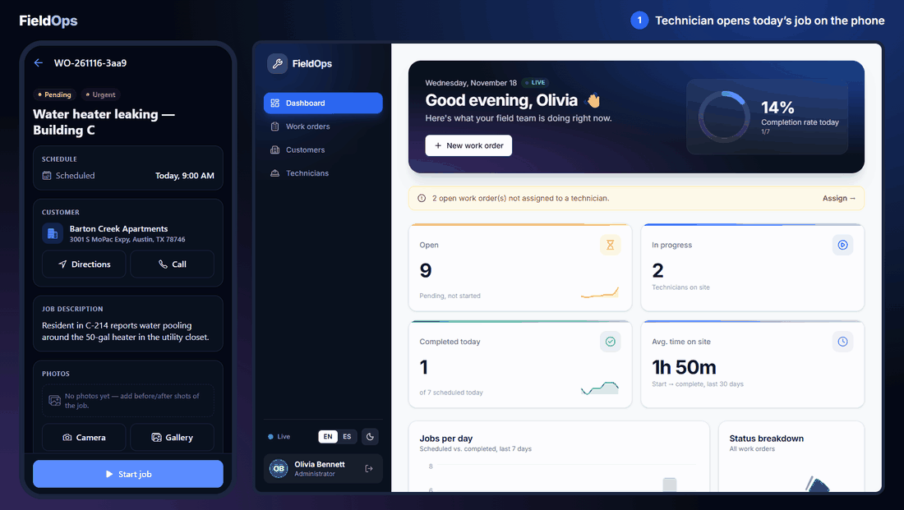
  <br/><sub>Technician app (left) and dispatcher dashboard (right) — every change on the phone appears on the dashboard instantly.</sub>
</p>

---

## The problem

Field-service companies still run on paper and WhatsApp:

- Work orders are printed or texted; dispatchers don't know a job is done until someone calls.
- Proof of work (photos, customer signature) lives in personal phones or gets lost.
- Supplier invoices and delivery notes are re-typed by hand into the back office — slow and error-prone.
- Managers have no reliable numbers: backlog, completion times, technician workload.

## The solution

| | |
|---|---|
| 📱 **Technician app** | Today's jobs sorted by urgency, one-tap **Start / Complete** flow, photos, **customer signature**, directions & call, persistent login, dark mode, EN/ES. |
| 🖥️ **Dispatcher dashboard** | Live KPIs and charts, create / assign / edit work orders, customers, technician status — **updates in real time** with toasts when a job starts, finishes or an invoice is scanned. |
| 🤖 **AI invoice scanning** | Photo of an invoice → Edge Function → **Claude vision** returns schema-validated JSON (vendor, number, date, line items, totals, confidence) → reviewed on the phone, verified by the dispatcher. |

<p align="center">
  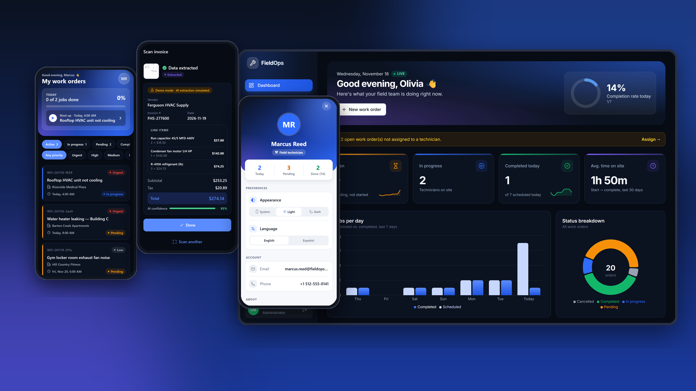
</p>

## Features

**Mobile app (React Native + Expo)**
- Email/password login with persisted session; route guards (`Stack.Protected`)
- *My work orders*: status & priority filters with counts, today's progress, "next up" shortcut, pull-to-refresh, **realtime** refresh when the dispatcher assigns a job
- Work-order detail: schedule timeline, customer card (maps directions, tap-to-call), description, notes
- Status flow **Pending → In progress → Completed** (timestamps set by a DB trigger on the server clock)
- Photos from camera or gallery → private Storage, shown through signed URLs
- **Signature capture** (react-native-svg, no WebView) saved as a crisp SVG
- **Scan invoice**: animated scanning UI, upload → AI extraction → review screen
- Light / dark / system theme and **English / Spanish**, persisted per device
- Skeleton loaders, empty and error states on every screen

**Admin panel (React + Vite + Tailwind)**
- Admin-only login (technicians are rejected; RLS enforces it server-side too)
- Dashboard: completion ring, KPI cards with sparklines, jobs-per-day, status breakdown, technician workload, today's jobs
- **Realtime**: one Supabase channel refreshes every open page and shows toasts ("WO-… completed by Marcus")
- Work orders: search + URL-synced filters, create / edit / assign / cancel
- Order detail: timeline, photo lightbox, signature, scanned documents with line items and *Mark verified*
- Customers CRUD (FK-safe delete), technician status cards
- Light / dark theme, EN / ES, code-split routes

**AI extraction (Supabase Edge Function)**
- Verifies the caller's JWT and that they may access the document (assigned technician or admin)
- **Live mode**: Claude vision + structured output validated against a Zod schema (official Anthropic SDK)
- **Demo mode** (no API key configured): the full pipeline runs for real, but the model call returns realistic simulated data — clearly labelled in both apps. Keeps the public demo free and abuse-proof.

## Architecture

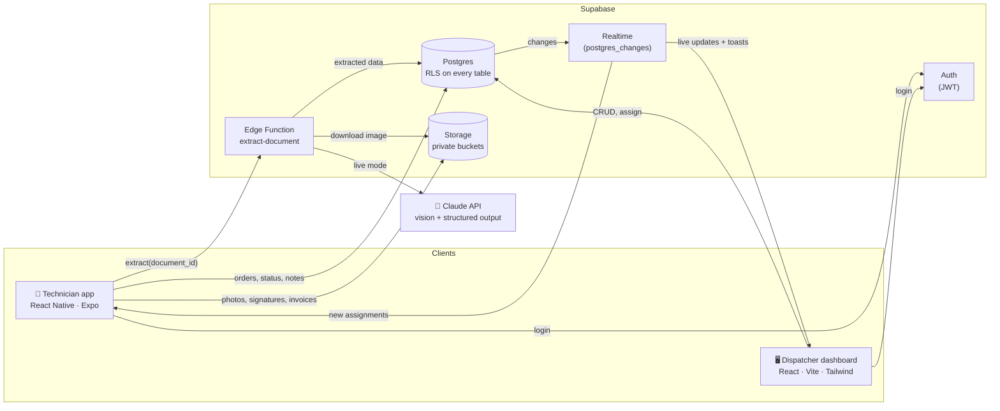

**Data model** — `profiles` (role: admin / technician), `customers`, `work_orders`
(status, priority, schedule, timestamps, signature), `work_order_photos`, `scanned_documents`
(extracted fields, `line_items` JSONB, raw AI output, confidence).

**Security**
- Row Level Security on all tables: admins (`is_admin()`) manage everything; technicians only
  see and update the orders assigned to them, and their photos / documents.
- Private storage buckets; files are only reachable through short-lived **signed URLs**.
- Only the Supabase *publishable* key ships in the apps. The AI key exists solely as an
  Edge Function secret.
- The Edge Function re-checks authorization (same rule as RLS) before touching a document.

## Tech stack

| Layer | Technology |
|---|---|
| Mobile | React Native 0.88, Expo SDK 58, Expo Router, TypeScript (strict), react-native-svg, expo-image-picker |
| Web admin | React 19, Vite, TypeScript (strict), Tailwind CSS v4, Recharts, React Router, lucide-react |
| Backend | Supabase — Postgres, Auth, Row Level Security, Storage, Realtime, Edge Functions (Deno) |
| AI | Claude (Anthropic SDK) — vision + structured outputs validated with Zod |
| Quality | Generated DB types, ESLint / oxlint, typed i18n dictionaries (missing translation = compile error) |

## Screenshots

### Technician app

| Sign in | My work orders | Job detail | AI invoice scan | Profile (light) |
|---|---|---|---|---|
| 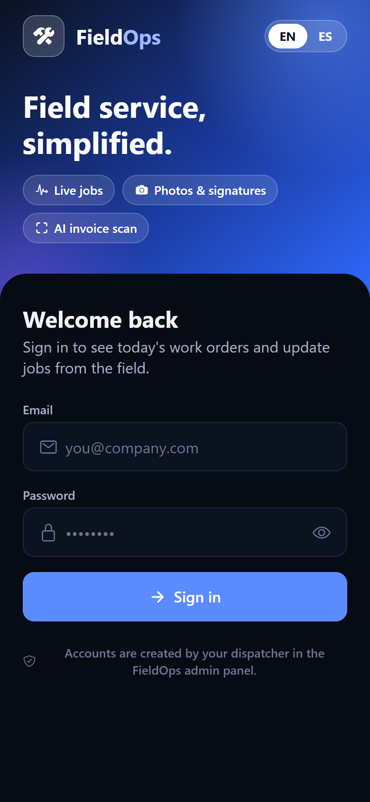 | 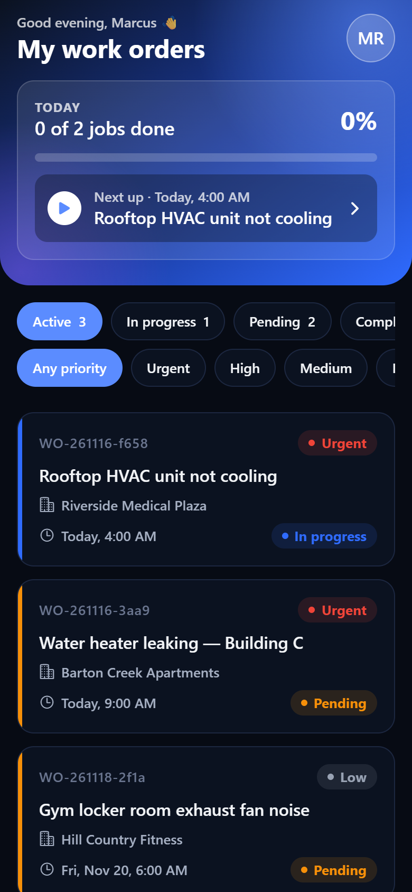 | 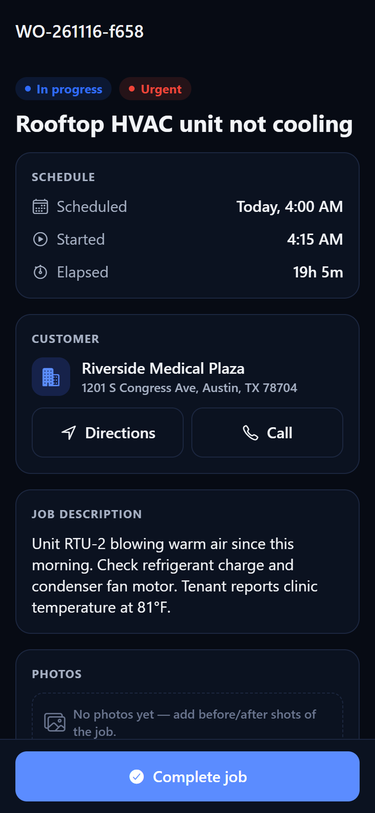 | 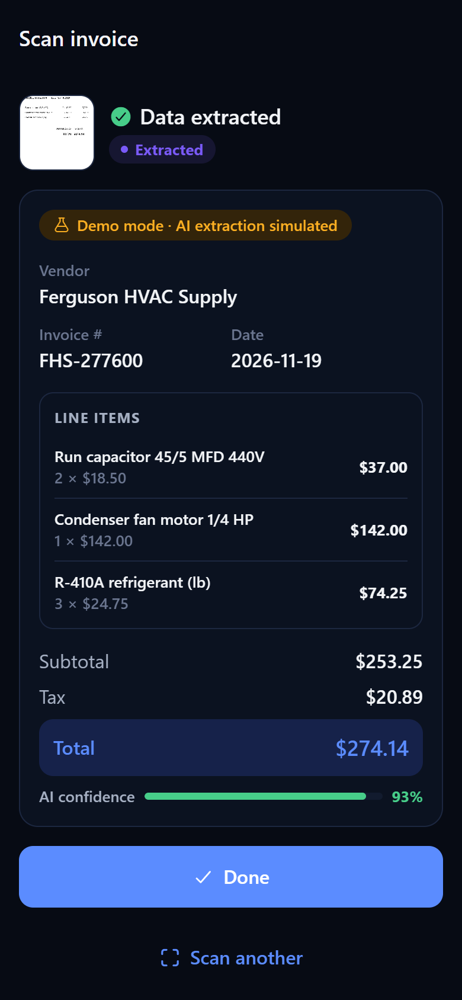 | 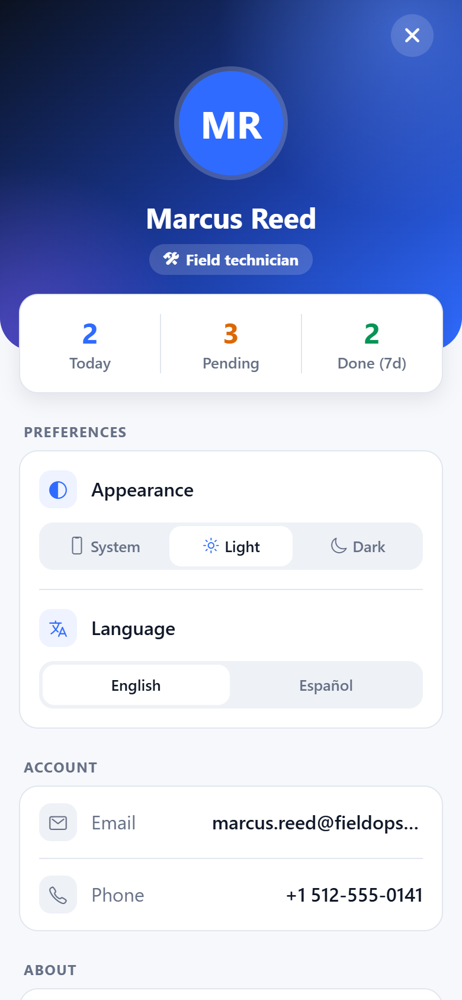 |

### Dispatcher dashboard

| Dashboard (dark) | Dashboard (light) |
|---|---|
| 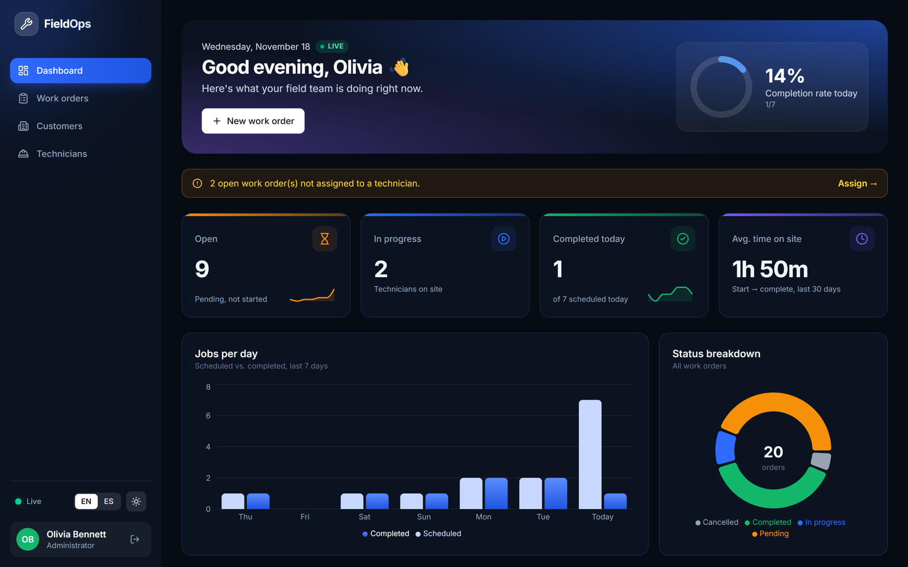 | 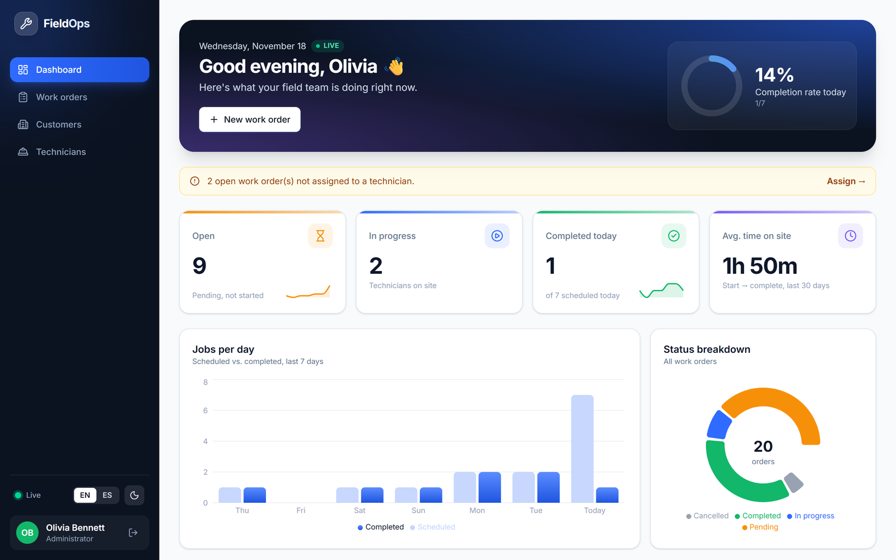 |
| **Work orders** | **Order detail + AI-extracted invoice** |
| 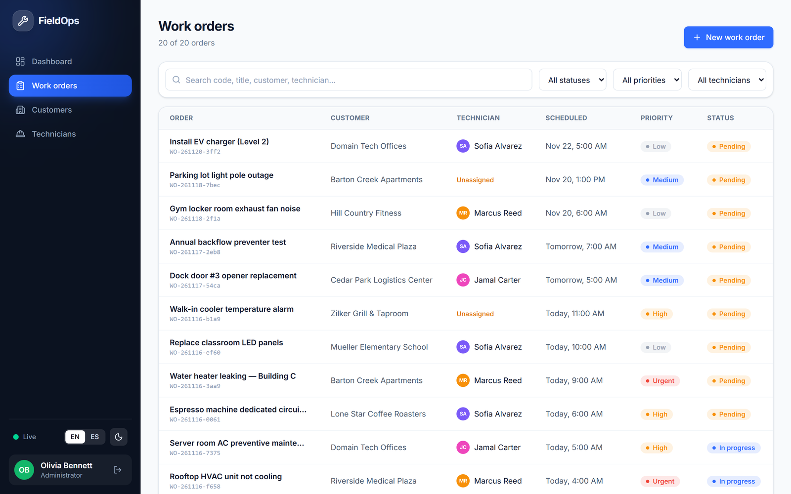 | 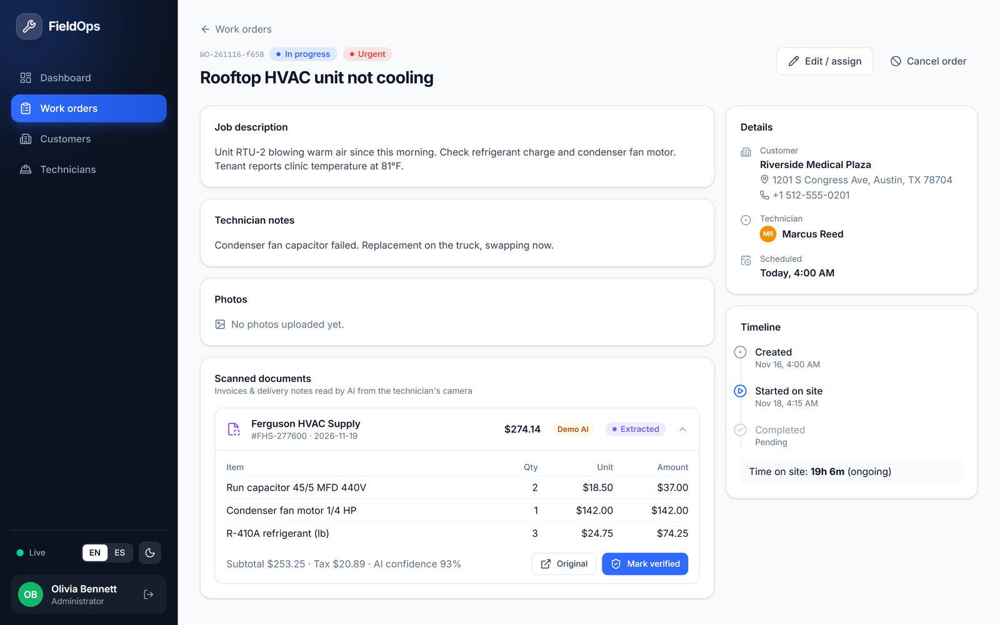 |
| **Technicians** | **Sign in** |
| 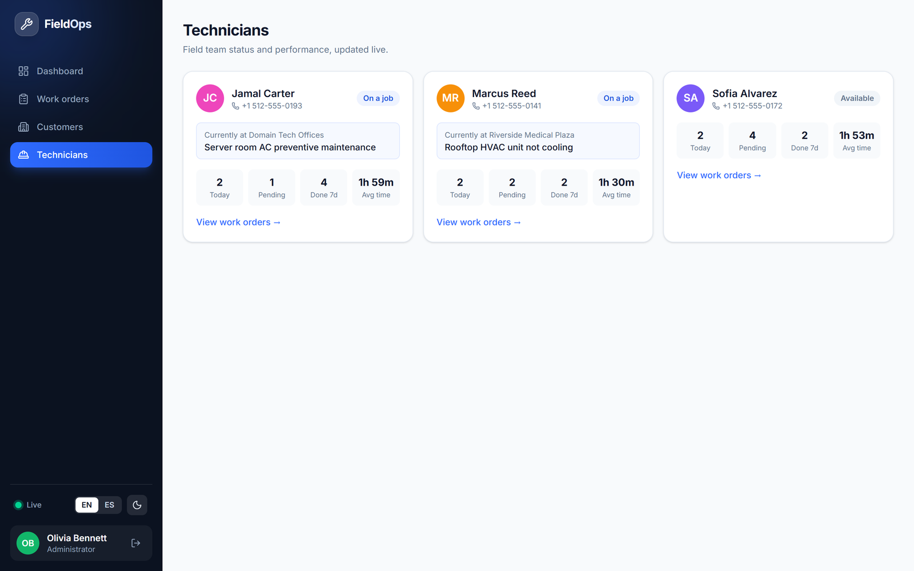 | 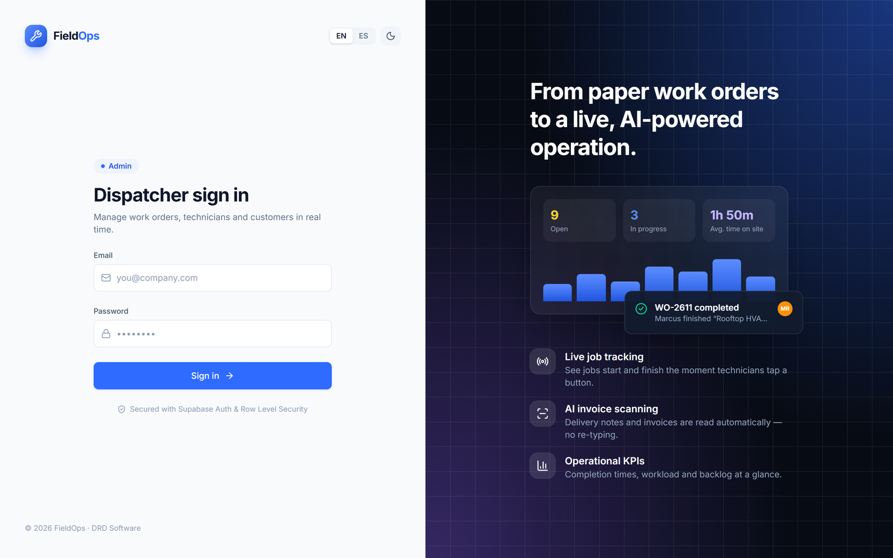 |

## Demo credentials

All demo accounts use the password **`FieldOps#2026`** (seed data — demo only).

| Role | Email | Use it in |
|---|---|---|
| Admin / dispatcher | `olivia.bennett@fieldops.demo` | Admin panel |
| Technician | `marcus.reed@fieldops.demo` | Mobile app |
| Technician | `sofia.alvarez@fieldops.demo` | Mobile app |
| Technician | `jamal.carter@fieldops.demo` | Mobile app |

> Tip for a live demo: open the admin dashboard on a laptop, sign in as Marcus on a phone, and
> start / complete a job or scan an invoice — the dashboard updates in real time.

## Getting started

**Prerequisites:** Node 20+, a Supabase project, the Expo Go app (or an emulator).

```bash
# 1. Mobile app
cp .env.example .env              # EXPO_PUBLIC_SUPABASE_URL / EXPO_PUBLIC_SUPABASE_KEY
npm install
npm start                         # scan the QR with Expo Go · press w for web

# 2. Admin panel
cd admin
cp .env.example .env              # VITE_SUPABASE_URL / VITE_SUPABASE_KEY
npm install
npm run dev                       # http://localhost:5173
```

**Database:** the schema (tables, enums, triggers, RLS policies, storage buckets) lives in the
Supabase project; demo data is in [`supabase/seed.sql`](supabase/seed.sql) — run it in the SQL
editor. It is idempotent and contains a commented RESET block.

**AI function:**

```bash
supabase functions deploy extract-document
supabase secrets set ANTHROPIC_API_KEY=sk-ant-...      # optional: enables live AI
supabase secrets set ANTHROPIC_MODEL=claude-opus-5-5   # optional model override
```

Without the API key the function runs in **demo mode** (simulated extraction, clearly labelled).

## Project structure

```
.
├── src/                          # 📱 Mobile app (Expo Router)
│   ├── app/                      #   screens: sign-in, (app)/index, orders/[id], scan, complete, profile
│   ├── components/ui/            #   design system: Button, TextField, Badge, Card, Skeleton, Gradient…
│   ├── features/work-orders/     #   data layer + OrderCard, PhotoGrid, SignaturePad, DocumentSummary
│   ├── i18n/                     #   typed EN/ES dictionaries
│   ├── providers/                #   Auth + Preferences (theme, language)
│   └── types/database.ts         #   generated Supabase types
├── admin/                        # 🖥️ Web admin (React + Vite)
│   └── src/{pages,components,realtime,i18n,lib}
├── supabase/
│   ├── functions/extract-document/  # 🤖 Edge Function (live + demo mode)
│   └── seed.sql                  #   demo users, customers, 20 work orders
└── docs/images/                  # screenshots, demo GIF, banner
```

## Engineering decisions

- **Supabase over a custom API** — Postgres + RLS gives row-level authorization in one place,
  and Realtime makes the live dashboard a few lines of code instead of a websocket server.
- **RLS as the source of truth** — the UI hides what a user can't do, but the database enforces
  it; the admin-only login check is a convenience, not the security boundary.
- **Server-side timestamps** — `started_at` / `completed_at` are set by a trigger, so KPIs can't be
  skewed by a phone's clock.
- **SVG signatures** — tiny, resolution-independent, render natively in the dashboard.
- **AI behind an Edge Function** — keys never reach a client; the output is schema-validated
  before it touches the database; failures are recorded (`failed`) instead of lost.
- **Demo mode for AI** — a public portfolio demo shouldn't burn API credits or be abusable;
  flipping one secret switches to live extraction with no code changes.

## Roadmap

- Offline queue for status changes and photos (sync when back online)
- Map view of today's jobs and route optimisation
- Push notifications on assignment
- PDF service report with photos + signature emailed to the customer
- Export verified invoices to accounting (QuickBooks / Xero)

---

<p align="center">
  Built by <b>Danilo Romero — DRD Software</b> · Systems Engineer · Custom web & mobile apps, databases & automation
</p>
